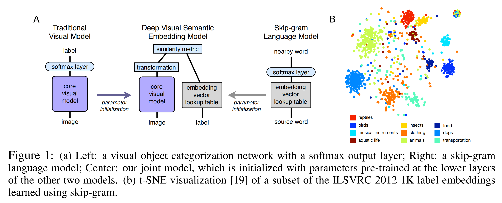
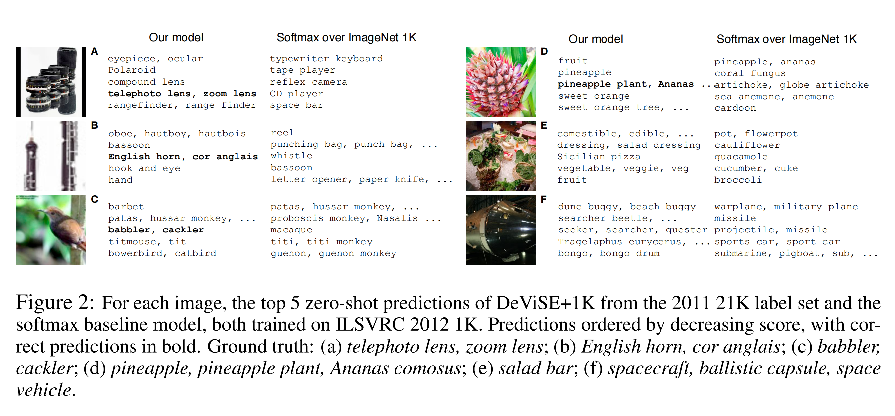

# DeViSE - two speakers / 双人演讲稿

A: slides 1-9 / 第 1-9 页。B: slides 10-19 / 第 10-19 页。Slide 20 is a shared reference page / 第 20 页为共用参考页。Each speaker has a 15:00 budget, including videos, demonstrations and the handover; Q&A follows / 每人限时 15:00，含视频、演示和交接，问答另计。Choose one language for delivery; the second is an alternative / 现场选择一种语言，中英文不重复朗读。

## DeViSE - 讲者 A

逐页中文演讲稿 · 第 1-9 页 · 每人 15:00

## 分工与计时

**本稿由讲者 A 使用，主题：研究问题、模型与推断。** A 负责第 1-9 页，B 负责第 10-19 页，第 20 页为共用参考页。

**个人计时 00:00-15:00：正文目标 14:30，缓冲 00:30。** 全场排练基准为 00:00-15:00；A 可提前交接，B 接棒时将个人计时归零，不必等满第 15 分钟。

- 中英文是两个可选版本。正式演讲选一种语言；两人使用一致语言，本稿不要求重复讲两遍。
- 视频合计 40 秒、互动、45 秒排序演示或 20 秒候选切换（如适用）、停顿与交接均已计入。视频只播一次，播放时不重复朗读录制旁白。
- 方括号内为操作提示，不朗读。每个互动问题只收一个简短回答；演示时照稿讲解，不额外扩展预设。
- 英文按每分钟 110 个词估算；中文按每分钟 200 个等效单位估算，外文与数字加算时间。时间为排练规划，请按每页累计节点试讲。
- 若到 14:30 仍未收束，A 直接说交接语，B 直接说最后三个结论；略过追加互动，不重播视频，并在个人 15:00 前结束。第 20 页与问答均在两人演讲之后使用。

| 页码与标题 | 个人时间 | 全场基准 | 视频 |
|---|---|---|---:|
| 1. 模型能认出从未见过的类别吗？ | 00:00-01:15 | 00:00-01:15 | 0s |
| 2. 没有训练图片，不等于没有信息 | 01:15-02:30 | 01:15-02:30 | 0s |
| 3. 连接图像与词语的研究缺口 | 02:30-03:45 | 02:30-03:45 | 0s |
| 4. 两个预训练模型，一个语义接口 | 03:45-05:25 | 03:45-05:25 | 20s |
| 5. 语义结构从哪里来 | 05:25-07:40 | 05:25-07:40 | 20s |
| 6. 不仅靠近正确标签，还要排在错误标签之前 | 07:40-09:20 | 07:40-09:20 | 0s |
| 7. 训练时哪些参数会更新？ | 09:20-10:35 | 09:20-10:35 | 0s |
| 8. 逐步检查一次排序更新 | 10:35-12:35 | 10:35-12:35 | 0s |
| 9. 候选词表会改变答案 | 12:35-14:30 | 12:35-14:30 | 0s |

**个人 14:30-15:00 仅作缓冲，已包含在 15 分钟限时内。**

## 1. 模型能认出从未见过的类别吗？

**流程时间：个人 00:00-01:15；全场基准 00:00-01:15。** 讲者 A。视频 0 秒，互动或演示 5 秒，停顿与换页 4 秒，均已计入。

大家好，今天我们两人一起介绍 DeViSE：怎样把视觉识别和语言中学到的含义连接起来。我先解释模型怎样工作、怎样预测，再由我的搭档分析实验证据与局限。

先想一个问题。假设一个分类器学会了认狗，但输出层里根本没有“鲨鱼”这个标签，它还能把一张图片叫作鲨鱼吗？识别一张新照片，和识别一个新类别，是两回事。

**互动问题:** 固定的 softmax 输出层，能预测一个不在输出列表里的标签吗？

DeViSE 尝试借助文本跨过这道鸿沟。要理解它怎么做，我们先得说清楚：“未见”究竟指什么。

依据： Frome et al. (2013), p.1

## 2. 没有训练图片，不等于没有信息

**流程时间：个人 01:15-02:30；全场基准 01:15-02:30。** 讲者 A。视频 0 秒，互动或演示 5 秒，停顿与换页 4 秒，均已计入。

在这篇论文里，未见类别是指视觉模型没有该类的有标注训练图像。这不等于系统对它一无所知；类别名称仍然可能出现在语言模型使用的文本里。

例如，视觉模型见过某些鲨鱼种类，而文本为另一种鲨鱼提供了词向量。目标就是把有用的结构迁移过去。

这里还要分清两个集合：接受测试的图像，和允许作为答案的标签。把已见标签加入候选答案，并不会改变测试图像。

**互动问题:** 对于未见类别，系统还可以获得什么信息？

明确这个设置之后，我们再看，早期方法还缺少哪一环。

依据： Frome et al. (2013), p.2

## 3. 连接图像与词语的研究缺口

**流程时间：个人 02:30-03:45；全场基准 02:30-03:45。** 讲者 A。视频 0 秒，互动或演示 5 秒，停顿与换页 4 秒，均已计入。

当时，主要的构件已经存在：卷积网络能学习有用的视觉特征，语言模型也能把含义相关的词放在相近的位置。难点是把两者连接起来，并让这种连接适用于大得多的标签词表。

这就是论文的贡献：把预训练视觉特征、从文本得到的标签表示和排序目标结合起来，做到 ImageNet 的规模。作者用一千个视觉类别训练，再研究向大约两万个额外标签迁移。

多项设计同时发生了变化，所以应评价整套方法，不能把所有改善都归因于规模。

**互动问题:** 语义标签表示带来了什么，是单纯扩大 softmax 不能提供的？

接下来，我们沿着信息流看一遍模型。

依据： Frome et al. (2013), p.2

## 4. 两个预训练模型，一个语义接口

**流程时间：个人 03:45-05:25；全场基准 03:45-05:25。** 讲者 A。视频 20 秒，互动或演示 5 秒，停顿与换页 4 秒，均已计入。

**播放前 · 演讲者说：**

先用二十秒抓住整体思路。请留意图像怎样从视觉特征进入一个与标签含义共享的空间。然后，我们再回到作者的原图，检查具体细节。

**播放提示 · DeViSE 总览 · 中文 · 20 秒：**

播放一次中文总览视频。等录制旁白完整结束，再继续讲解。

[播放视频（20 秒）](../media/devise-20s-zh.mp4)

[字幕](../media/devise-20s-zh.srt)

**视频旁白 · 已录制，请勿重复朗读：**

没有斑马训练图，也能认出斑马吗？先用文本学词向量，用图片训练视觉网络。再把图像投影到语义空间，让正确标签得分更高。预测时比较标签得分，也能选择未见类别。前提是，已有它的词向量。

**播放后 · 演讲者说：**

关键的一步，是把固定输出类别的分类，改成图像向量与候选标签向量之间的比较。文本提供标签表示，训练图像教会视觉映射。只要有对应嵌入，新标签就能加入比较。这为零样本识别提供了一条路径，但不保证预测一定正确。

**互动问题:** 哪个部分把视觉特征连接到标签空间？

**衔接 Figure 1 · 演讲者说：**

刚才是整体思路。现在看原始 Figure 1，弄清两种表示从哪里来，以及模型到底学习了什么。

依据： Frome et al. (2013), p.3

## 5. 语义结构从哪里来

**流程时间：个人 05:25-07:40；全场基准 05:25-07:40。** 讲者 A。视频 20 秒，互动或演示 8 秒，停顿与换页 4 秒，均已计入。

[查看原论文页码 3](./devise-nips2013.pdf#page=3)

**播放前 · 演讲者说：**

Figure 1 有两个面板。接下来这段短片里，请跟着两个预训练模型进入联合系统，再看看 B 图中不同颜色的语义邻域。

**播放提示 · Figure 1 · 中文 · 20 秒：**

播放一次 Figure 1 中文视频，结束后再继续讲解。

[播放视频（20 秒）](../media/devise-figure-1-zh.mp4)

[字幕](../media/devise-figure-1-zh.srt)

**视频旁白 · 已录制，请勿重复朗读：**

DeViSE 如何连接视觉与语言？ 它结合预训练视觉网络，与固定的词向量。 学习一个投影，让图像对齐标签向量。 B 图展示标签之间的语义邻域，不是图像预测结果。

**播放后 · 演讲者说：**

A 图展示架构。指向中间的箭头表示参数初始化。视觉 softmax 被移除，学习到的投影把视觉特征映射到标签空间。视觉特征有四千零九十六维；论文使用五百维或一千维的标签嵌入。

B 图展示的是另一件事：用 t-SNE 可视化从文本学到的标签嵌入。在图像训练对齐两种模态之前，相关标签就已经形成邻域。这些点是标签，不是测试图像的预测；二维距离也不是分类分数。

词向量归一化后保持固定。先学习投影，再微调视觉网络。继续之前，我们先确认各部分的角色。

**互动问题:** B 图中的点是标签还是测试图像？图上的距离是预测分数吗？

**衔接排序损失 · 演讲者说：**

现在有了参照空间。怎样让图像更偏向正确标签，而不是竞争标签？这就是排序损失要解决的问题。

依据： Original Figure 1 and §3.1–3.3, p.3

## 6. 不仅靠近正确标签，还要排在错误标签之前

**流程时间：个人 07:40-09:20；全场基准 07:40-09:20。** 讲者 A。视频 0 秒，互动或演示 10 秒，停顿与换页 4 秒，均已计入。

这个目标关心的是先后顺序。我们希望正确标签的分数，比竞争标签至少高出一个小的间隔。

把铰链损失这一项读出来，就是：要求的间隔，减去正确标签分数，再加上竞争标签分数。如果正确标签已经充分领先，损失就是零；否则，这一对标签会产生学习信号。

做个简单计算：间隔是零点一，正确分数是零点六，竞争分数是零点五五，损失就是零点零五。正确标签虽然领先，但领先得还不够。

公式一写成求和；实际算法会抽取竞争标签，在第一个违反间隔的标签处停止，而不是每次更新都检查所有标签。

**互动问题:** 正确标签已经得分更高，为什么损失仍然大于零？

目标已经清楚了。接下来看看，它会改变模型的哪些部分。

依据： Frome et al. (2013), p.4

## 7. 训练时哪些参数会更新？

**流程时间：个人 09:20-10:35；全场基准 09:20-10:35。** 讲者 A。视频 0 秒，互动或演示 5 秒，停顿与换页 4 秒，均已计入。

预训练给模型一个起点，并不意味着所有部分都保持冻结。

作者先训练投影矩阵 M，再微调视觉网络，同时固定语言嵌入。论文采用异步随机梯度下降，并使用 Adagrad 学习率。

我们的教学示例刻意缩小了问题：固定二维视觉特征，只用普通梯度下降更新 M。这样能单独检查一个排序约束的影响，而不是假装复现完整的 ImageNet 训练。

**互动问题:** 视觉网络在整个训练过程中都保持冻结吗？

明确这个简化之后，我们走一遍更新，看看分数差是否按预期改变。

依据： Frome et al. (2013), p.4

## 8. 逐步检查一次排序更新

**流程时间：个人 10:35-12:35；全场基准 10:35-12:35。** 讲者 A。视频 0 秒，互动或演示 45 秒，停顿与换页 4 秒，均已计入。

现在看这个可计算的小示例。图像特征和标签向量都固定，只有投影发生变化。开始之前，先预测一下：正确分数与竞争分数之间的差距会怎样变化？

[演示提示 · 共 45 秒，含观众回答。间隔和学习率都设为 0.1；前进一步，查看分数差，再倒退，最后试一次零学习率。跳过额外预设和可选语义滑尺。]

这次有效更新后，分数差增大，损失下降。倒退可以恢复相同状态。把学习率设为零，模型就不变，说明结果确实由更新驱动。

这只是教学问题里的一个约束，不能证明真实训练中的每个样本每一步都会改善。这里的相似度分数也不是概率。

**互动问题:** 一次有效更新后，正确标签与竞争标签的分数差应该怎样变化？

我们看过学习怎样改变分数了。那么，如果分数不变，只改变可选答案，会发生什么？

依据： Teaching derivation from Eq.1, p.4; computed toy, not a reported experiment

## 9. 候选词表会改变答案

**流程时间：个人 12:35-14:30；全场基准 12:35-14:30。** 讲者 A。视频 0 秒，互动或演示 20 秒，停顿与换页 4 秒，均已计入。

保持图像向量不变，只改变候选列表。只有未见标签时，未见的鲨鱼标签获胜；让一个相近的已见鲨鱼标签参加竞争，第一名就可能换成这个熟悉标签。

[演示提示 · 共 20 秒，含观众回答。只切换一次“加入已见候选”，保持查询角度不变。]

这里没有重新训练。DeViSE-0 和 DeViSE+1K 表示同一个训练模型使用不同候选集合；两种设置都测试未见类别的图像。

当标签向量为单位长度、查询向量固定且非零时，点积与余弦的排序一致，但数值和固定间隔损失不一定相同。

**互动问题:** 加入已见候选时，模型权重改变了吗？

**交接给讲者 B · 演讲者说：**

我们已经看过 DeViSE 怎样做出预测。接下来要问的是：它表现怎样，又是在什么条件下成立？下面由我的搭档继续分析评估设置与实验结果。

依据： Frome et al. (2013), p.6

## 20. 来源、证据与可复算说明

**参考页，不计入限时演讲。** 两人共用，不逐项朗读。

[参考页 · 不计入限时演讲。不逐项朗读；留待单独的问答环节使用。]

下载区提供原文、官方补充材料、阅读指南和视频素材。报告结果注明论文来源；互动计算是教学示例。这里没有复现原始 ImageNet 训练。

**参考提问:** 哪些证据来自论文，哪些来自教学示例？

依据： Frome et al. (2013), p.1

## 问答准备 - 备用，不计入个人 15 分钟

两人演讲结束后再进入问答；以下为建议主答分工，另一位可以补充。

### 1. 文本出现过类名，为什么仍是零样本？

零样本相对于这些类别的视觉训练样本定义；语义辅助信息是明确允许的。

依据： §4.2, p.6

### 2. 原文联合训练会更新词向量吗？

原文固定词向量。脚注讨论同时训练语言模型的可能性，不是已报告流程。

依据： §3.3, p.4, footnote 5

### 3. 视觉骨干一直冻结吗？

不是。先训练 M，再微调视觉网络。

依据： §3.3, p.4

### 4. 为什么用排序损失而不是 L2？

预测依赖排序。Hinge 明确惩罚过于接近或超过正确标签的错误标签。论文报告 L2 较差，但不构成普遍保证。

依据： §3.3, p.4

### 5. 点积和余弦完全相同吗？

单位标签向量与固定非零查询下，排序相同；数值相差查询模长，固定间隔损失不一定相同。

依据： §3.3 + algebraic deduction

### 6. 相似度分数是概率吗？

不是。教学例子和论文目标使用点积分数，没有建立概率校准。

依据： Eq.1, p.4

### 7. DeViSE-0 和 +1K 是不同训练模型吗？

不是。是同一个训练模型，候选标签集合不同。

依据： Table 2 caption, p.6

### 11. 随机嵌入基线控制什么？

它移除学习到的标签语义结构、保留嵌入模型形式，支持语义有效，但不完美隔离全部混杂因素。

依据： §4 and Table 1

## DeViSE - Speaker A

English script by slide · Slides 1-9 · Budget 15:00

## Roles and timing

**This script is for Speaker A: Research question, model and inference.** A covers slides 1-9; B covers slides 10-19. Slide 20 is the shared reference page.

**Your timer runs from 00:00 to 15:00: target 14:30, with 00:30 contingency.** The rehearsal talk clock is 00:00-15:00. A may hand over earlier; B resets the personal timer on taking over. There is no need to wait until 15:00.

- Chinese and English are alternative versions. Choose one delivery language for both speakers; do not deliver both versions back to back.
- The 40 seconds of video, audience responses, applicable 45-second ranking / 20-second candidate demonstrations, pauses and spoken handover are included. Play each clip once; do not read its recorded narration aloud.
- Brackets contain unspoken operating cues. Take one brief audience response per question. Speak the prepared explanation during a demonstration; do not add extra presets.
- Estimates use 110 English words or 200 equivalent Chinese units per minute, with additional allowance for foreign terms and digits in Chinese. Rehearse against the cumulative slide deadlines.
- If still speaking at 14:30, A goes straight to the handover and B goes straight to the three takeaways. Skip extra responses, do not replay clips, and stop by your own 15:00. Slide 20 and Q&A follow both timed parts.

| Slide and title | Your clock | Talk clock | Video |
|---|---|---|---:|
| 1. Can a model name what it has never seen? | 00:00-01:15 | 00:00-01:15 | 0s |
| 2. Zero images is not zero information | 01:15-02:30 | 01:15-02:30 | 0s |
| 3. The missing link between images and words | 02:30-03:45 | 02:30-03:45 | 0s |
| 4. Two pretrained models. One semantic interface. | 03:45-05:25 | 03:45-05:25 | 20s |
| 5. Where the semantic structure comes from | 05:25-07:40 | 05:25-07:40 | 20s |
| 6. Learn an ordering, not just a destination | 07:40-09:20 | 07:40-09:20 | 0s |
| 7. What changes during training? | 09:20-10:35 | 09:20-10:35 | 0s |
| 8. Inspect one ranking update | 10:35-12:35 | 10:35-12:35 | 0s |
| 9. The candidate vocabulary changes the answer | 12:35-14:30 | 12:35-14:30 | 0s |

**Your 14:30-15:00 window is contingency, already inside the 15-minute limit.**

## 1. Can a model name what it has never seen?

**Run of show: your clock 00:00-01:15; talk clock 00:00-01:15.** Speaker A. Includes 0s video, 5s activity and 4s pauses/changeover.

Hello everyone. Today we’ll discuss DeViSE: connecting visual recognition with meaning learned from language. I’ll explain the model and how it makes predictions. My co-presenter will examine the evidence and its limits.

Let me start with a question. Suppose a classifier has learned to recognize dogs, but its output layer has no label for a shark. Could it ever call an image a shark? Recognizing a new photograph is one thing; recognizing a new category is another.

**Brief audience check:** Could a fixed softmax layer predict a label that is absent from its outputs?

DeViSE tries to bridge that gap using text. To understand how, we first need to be clear about what “unseen” means.

Source: Frome et al. (2013), p.1

## 2. Zero images is not zero information

**Run of show: your clock 01:15-02:30; talk clock 01:15-02:30.** Speaker A. Includes 0s video, 5s activity and 4s pauses/changeover.

In this paper, an unseen class has no labeled training images available to the visual model. That does not mean the system knows nothing about it. Its name can still appear in the language model’s text.

For example, the visual model may see some shark species, while text supplies a vector for another. The aim is to transfer useful structure across that gap.

There are also two separate sets to keep track of: the images being tested, and the labels allowed as answers. Adding familiar labels to the answer list does not change the test images.

**Brief audience check:** What information is still available for an unseen class?

With that setting in mind, what was missing from the earlier approaches?

Source: Frome et al. (2013), p.2

## 3. The missing link between images and words

**Run of show: your clock 02:30-03:45; talk clock 02:30-03:45.** Speaker A. Includes 0s video, 5s activity and 4s pauses/changeover.

The building blocks were already there: convolutional networks could learn useful visual features, and language models could place related words near one another. The challenge was to connect them in a way that worked across a much larger vocabulary.

That is the paper’s contribution: strong pretrained visual features, text-derived label representations, and a ranking objective, brought together at ImageNet scale. The authors train on a thousand visual classes and investigate transfer to roughly twenty thousand additional labels.

Several design choices changed together, so we should judge the full method rather than attribute every improvement to scale.

**Brief audience check:** What does a semantic label representation add that a larger softmax does not?

Let’s now follow the information through the model.

Source: Frome et al. (2013), p.2

## 4. Two pretrained models. One semantic interface.

**Run of show: your clock 03:45-05:25; talk clock 03:45-05:25.** Speaker A. Includes 20s video, 5s activity and 4s pauses/changeover.

**Before playback — say:**

Here’s the idea in twenty seconds. Watch how the image moves from visual features into a space shared with label meanings. We’ll then return to the authors’ original diagram to examine the details.

**Playback cue — DeViSE overview · English · 20 seconds:**

Play the English overview once. Let its narration finish before speaking again.

[Play video (20 seconds)](../media/devise-20s-en.mp4)

[Subtitles](../media/devise-20s-en.srt)

**Video narration — recorded, do not read over it:**

Can a model recognize classes it's never trained on? DeViSE learns word embeddings and visual features. Then it maps images into a shared space, so the correct labels score higher. It can even predict unseen classes, if their word embeddings are available.

**After playback — say:**

The key move is to replace a fixed list of output classes with a comparison between an image vector and candidate label vectors. Text supplies the label representations; training images teach the visual mapping. A new label can enter that comparison if its embedding is available. That gives us a route to zero-shot recognition, although it does not guarantee a correct prediction.

**Brief audience check:** Which component connects the visual features to the label space?

**Transition to Figure 1 — say:**

That was the overview. Now let’s use the original Figure 1 to see where the two representations come from and what is actually learned.

Source: Frome et al. (2013), p.3

## 5. Where the semantic structure comes from

**Run of show: your clock 05:25-07:40; talk clock 05:25-07:40.** Speaker A. Includes 20s video, 8s activity and 4s pauses/changeover.

[Open original paper page 3](./devise-nips2013.pdf#page=3)

**Before playback — say:**

Figure 1 has two panels. In this short clip, follow the two pretrained models into the joint system, then look at the colored neighborhoods in panel B.

**Playback cue — Figure 1 · English · 20 seconds:**

Play the English Figure 1 video once; resume after it finishes.

[Play video (20 seconds)](../media/devise-figure-1-en.mp4)

[Subtitles](../media/devise-figure-1-en.srt)

**Video narration — recorded, do not read over it:**

How does DeViSE connect vision and language? It combines a pretrained visual network with fixed word embeddings. A learned projection aligns images with label vectors. Panel B shows semantic neighborhoods among labels, not image predictions.

**After playback — say:**

Panel A shows the architecture. The arrows into the middle indicate parameter initialization. The visual softmax is removed, and a learned projection maps visual features into the label space. The visual features have four thousand and ninety-six dimensions; the paper uses label embeddings with five hundred or a thousand dimensions.

Panel B shows something different: text-derived label embeddings, visualized with t-SNE. Related labels form neighborhoods before image training aligns the two modalities. These dots are labels, not test-image predictions. Their two-dimensional distances are not classification scores.

The word vectors are normalized and kept fixed. The projection is learned first, and the visual network is fine-tuned later. Let’s check those roles before moving on.

**Brief audience check:** In panel B, are the dots labels or test images? Are the plotted distances prediction scores?

**Transition to the ranking loss — say:**

So we have our reference space. How do we teach an image to prefer the correct label over a competing one? That is the job of the ranking loss.

Source: Original Figure 1 and §3.1–3.3, p.3

## 6. Learn an ordering, not just a destination

**Run of show: your clock 07:40-09:20; talk clock 07:40-09:20.** Speaker A. Includes 0s video, 10s activity and 4s pauses/changeover.

The objective is about an ordering. We want the correct label to score higher than a competing label by at least a small margin.

Read the hinge term as: the margin, minus the correct score, plus the competing score. If the correct label is already far enough ahead, the loss is zero. Otherwise, that pair produces a learning signal.

For our quick calculation, the margin is point one, the correct score is point six, and the competing score is point five five. The loss is point zero five. The correct label leads, but not by enough.

Equation one is written as a sum. In practice, the algorithm samples competing labels and stops at the first margin violation, rather than checking every label on every update.

**Brief audience check:** Why is the loss positive even though the correct label already scores higher?

That explains the objective. Next, let’s identify which parts of the model it changes.

Source: Frome et al. (2013), p.4

## 7. What changes during training?

**Run of show: your clock 09:20-10:35; talk clock 09:20-10:35.** Speaker A. Includes 0s video, 5s activity and 4s pauses/changeover.

Pretraining gives the model a starting point; it does not mean that every component stays frozen.

The authors first train the projection matrix, M. They then fine-tune the visual network while keeping the language embeddings fixed. The paper uses asynchronous stochastic gradient descent with Adagrad learning rates.

Our teaching example is deliberately smaller. We freeze a two-dimensional visual feature and update only M using plain gradient descent. That lets us inspect the effect of one ranking constraint without pretending to reproduce the full ImageNet training run.

**Brief audience check:** Does the visual network stay frozen throughout training?

With that simplification clear, let’s walk through one update and see whether the score gap changes as expected.

Source: Frome et al. (2013), p.4

## 8. Inspect one ranking update

**Run of show: your clock 10:35-12:35; talk clock 10:35-12:35.** Speaker A. Includes 0s video, 45s activity and 4s pauses/changeover.

Here is our small, computed example. The image feature and label vectors are fixed; only the projection changes. Before I advance it, predict what will happen to the gap between the correct and competing scores.

[Demo cue — 45 seconds, including the audience response. Use margin 0.1 and learning rate 0.1; advance once, inspect the gap, rewind, then try learning rate zero. Skip extra presets and the optional slide-rule.]

After that active update, the gap increases and the loss falls. Rewinding restores the same state. Setting the learning rate to zero leaves the model unchanged, which confirms that the update drives the result.

This is one constraint in a toy problem. It does not show that every real training example improves on every step. And these similarity scores are not probabilities.

**Brief audience check:** After an active update, what should happen to the correct-label score gap?

We’ve now seen how a score changes during learning. What happens if the scores stay fixed, but the available answers change?

Source: Teaching derivation from Eq.1, p.4; computed toy, not a reported experiment

## 9. The candidate vocabulary changes the answer

**Run of show: your clock 12:35-14:30; talk clock 12:35-14:30.** Speaker A. Includes 0s video, 20s activity and 4s pauses/changeover.

Let’s keep the image vector fixed and change only the candidate list. With unseen labels alone, the unseen shark label wins. Allow a nearby seen shark label to compete, and that familiar label can take first place.

[Demo cue — 20 seconds, including the audience response. Toggle seen candidates once; keep the query angle unchanged.]

Nothing was retrained. DeViSE zero and DeViSE plus one thousand describe different candidate sets for the same trained model. Both settings still test unseen-class images.

With unit-length labels and a fixed nonzero query, dot product and cosine rankings agree. Their numeric values and fixed-margin losses need not.

**Brief audience check:** When I add seen labels to the candidates, have the model weights changed?

**Handover to Speaker B - say:**

We’ve seen how DeViSE makes a prediction. The next question is how well it works, and under which conditions. I’ll hand over to my co-presenter to examine the evaluation and results.

Source: Frome et al. (2013), p.6

## 20. Sources, evidence and reproducibility

**Reference only - outside the timed talk.** Shared by both speakers; do not read it item by item.

[Reference slide — outside the timed talk. Do not read this slide aloud; use it during the separate Q&A.]

The original paper, official supplement, reading guide, and video assets are available in the downloads. Reported results are attributed to the paper; the interactive calculations are teaching examples. No original ImageNet training run is reproduced here.

**Reference prompt:** Which evidence comes from the paper, and which from the teaching examples?

Source: Frome et al. (2013), p.1

## Q&A preparation - backup, outside your 15 minutes

Start Q&A after both timed parts. These are suggested lead answers; the other speaker may add detail.

### 1. Why is this zero-shot if text includes the class name?

Zero-shot is defined relative to visual training examples for those classes. Semantic side information is explicitly available.

Source: §4.2, p.6

### 2. Are word embeddings updated in the reported joint training?

They are held fixed. A footnote discusses possible joint language training as an extension, not the reported procedure.

Source: §3.3, p.4, footnote 5

### 3. Is the visual backbone always frozen?

No. M is trained first; the visual network is fine-tuned later.

Source: §3.3, p.4

### 4. Why ranking loss rather than L2?

Prediction is based on label ordering. The hinge explicitly penalizes wrong labels that score too close to or above the correct one. The paper reports poorer L2 results, not a universal guarantee.

Source: §3.3, p.4

### 5. Are dot product and cosine identical?

For unit label vectors and a fixed nonzero query, they induce the same ranking. Their values differ by query norm; fixed-margin losses need not be identical.

Source: §3.3 + algebraic deduction

### 6. Is the displayed similarity a probability?

No. The toy and paper objective use dot-product scores. No probability calibration is established.

Source: Eq.1, p.4

### 7. Are DeViSE-0 and DeViSE+1K different trained models?

No. They are the same trained model evaluated with different candidate label sets.

Source: Table 2 caption, p.6

### 11. What does the random embedding baseline control?

It removes learned semantic label structure while retaining the embedding-based model form. It supports, but does not perfectly isolate, the value of text semantics.

Source: §4 and Table 1

## DeViSE - 讲者 B

逐页中文演讲稿 · 第 10-19 页 · 每人 15:00

## 分工与计时

**本稿由讲者 B 使用，主题：评估、结果与批判性讨论。** A 负责第 1-9 页，B 负责第 10-19 页，第 20 页为共用参考页。

**个人计时 00:00-15:00：正文目标 14:30，缓冲 00:30。** 全场排练基准为 15:00-30:00；A 可提前交接，B 接棒时将个人计时归零，不必等满第 15 分钟。

- 中英文是两个可选版本。正式演讲选一种语言；两人使用一致语言，本稿不要求重复讲两遍。
- 视频合计 20 秒、互动、45 秒排序演示或 20 秒候选切换（如适用）、停顿与交接均已计入。视频只播一次，播放时不重复朗读录制旁白。
- 方括号内为操作提示，不朗读。每个互动问题只收一个简短回答；演示时照稿讲解，不额外扩展预设。
- 英文按每分钟 110 个词估算；中文按每分钟 200 个等效单位估算，外文与数字加算时间。时间为排练规划，请按每页累计节点试讲。
- 若到 14:30 仍未收束，A 直接说交接语，B 直接说最后三个结论；略过追加互动，不重播视频，并在个人 15:00 前结束。第 20 页与问答均在两人演讲之后使用。

| 页码与标题 | 个人时间 | 全场基准 | 视频 |
|---|---|---|---:|
| 10. 先读实验协议，再读结果 | 00:00-01:25 | 15:00-16:25 | 0s |
| 11. 正确标签与合理错误是两种指标 | 01:25-02:45 | 16:25-17:45 | 0s |
| 12. 准确率接近，错误结构不同 | 02:45-04:10 | 17:45-19:10 | 0s |
| 13. 候选标签越多，测试越困难 | 04:10-06:30 | 19:10-21:30 | 20s |
| 14. 语义改善也有边界 | 06:30-07:35 | 21:30-22:35 | 0s |
| 15. 候选集合可以改变方法排名 | 07:35-08:45 | 22:35-23:45 | 0s |
| 16. 证据还没有证明什么 | 08:45-10:40 | 23:45-25:40 | 0s |
| 17. 与 ProtoNet 建立联系，但不混淆任务 | 10:40-11:50 | 25:40-26:50 | 0s |
| 18. 可以扩展的标签词表 | 11:50-12:50 | 26:50-27:50 | 0s |
| 19. 带走三个结论 | 12:50-14:30 | 27:50-29:30 | 0s |

**个人 14:30-15:00 仅作缓冲，已包含在 15 分钟限时内。**

## 10. 先读实验协议，再读结果

**流程时间：个人 00:00-01:25；全场基准 15:00-16:25。** 讲者 B。视频 0 秒，互动或演示 5 秒，停顿与换页 4 秒，均已计入。

谢谢。刚才我们了解了模型怎样工作，接下来我会重点看实验究竟支持哪些结论。看主要数字前，先确认它们怎么得来。

在主要的已见类别评估中，作者划分了原始 ImageNet 验证集：五千张用于模型选择，四万五千张用于报告结果。这不是竞赛隐藏测试集。补充材料还说明，测试使用单个中心裁剪，softmax 基线采用相同评估流程。

零样本实验直接复用五百维模型，没有进一步调参。但 Table 4 改用了不同年份的数据集和类别划分，不能把它的百分比与 Table 2 当作同一个任务直接比较。

**互动问题:** 为什么 Table 2 和 Table 4 回答的是不同的实验问题？

协议清楚之后，下一个问题是：怎样才算预测成功？

依据： Supplement §A.1, p.1; main paper pp.6–8

## 11. 正确标签与合理错误是两种指标

**流程时间：个人 01:25-02:45；全场基准 16:25-17:45。** 讲者 B。视频 0 秒，互动或演示 8 秒，停顿与换页 4 秒，均已计入。

假设真实标签是一种鸟，模型却预测了相关的另一种鸟。按准确标签评估，这仍然是错的；层级指标则可以给语义相近的答案一定认可。

可接受集合会沿着分类层级，在真实标签周围逐步扩展，直到至少包含 k 个标签。由于每次加入整个邻域，集合大小可能超过 k。

所以，层级精度与准确标签正确率回答的是不同问题，而且依赖分类层级。当 k 等于一时，只有准确标签可接受；换成相同单位后，两种指标一致。

**互动问题:** 层级分数更高，是否一定意味着准确物种预测更多？

带着这个区别，我们来看已见类别的结果。

依据： Main §4, pp.4–5; Supplement §A.3, pp.2–3

## 12. 准确率接近，错误结构不同

**流程时间：个人 02:45-04:10；全场基准 17:45-19:10。** 讲者 B。视频 0 秒，互动或演示 8 秒，停顿与换页 4 秒，均已计入。

熟悉的一千个类别上，结果很接近。Top-1 中，softmax 是百分之五十五点六，一千维 DeViSE 是百分之五十四点九。Top-5 几乎打平：百分之七十八点五，对百分之七十八点四。

部分层级分数有所提高，说明错误的结构可能不同，而不是准确标签正确率有明确的全面优势。

随机嵌入基线帮助我们检查：文本带来的标签几何结构有没有用。它保留大体架构，却去掉标签间有意义的组织。这是有用证据，但没有控制所有可能的训练差异。

**互动问题:** 哪个基线检验有意义的标签几何结构是否有用？

已见类别先看到这里。更有特色的测试是：没有某类的训练图像，模型还能叫出它的名字吗？

依据： Table 1, p.5

## 13. 候选标签越多，测试越困难

**流程时间：个人 04:10-06:30；全场基准 19:10-21:30。** 讲者 B。视频 20 秒，互动或演示 10 秒，停顿与换页 4 秒，均已计入。

[查看原论文页码 6](./devise-nips2013.pdf#page=6)

**播放前 · 演讲者说：**

Figure 2 是作者选取的零样本案例。请留意一次准确预测、一次合理但未命中的预测，以及一个基线更好的例子。

**播放提示 · Figure 2 · 中文 · 20 秒：**

播放一次 Figure 2 中文视频，结束后再继续讲解。

[播放视频（20 秒）](../media/devise-figure-2-zh.mp4)

[字幕](../media/devise-figure-2-zh.srt)

**视频旁白 · 已录制，请勿重复朗读：**

模型能识别未见类别吗？ 镜头的正确标签，排第四。 沙拉吧，两个模型都没命中。 而飞船，softmax 的预测更相关。 案例展示优点与局限，不代表总体准确率。

**播放后 · 演讲者说：**

镜头的准确标签排在第四。沙拉吧的准确标签两者都没命中；航天器的预测，作者认为 softmax 更接近正确答案。这说明迁移有用，也有局限。

两者都在 ImageNet 一千类上训练。DeViSE 搜索更大的标签词表，softmax 只能输出训练标签。D 图里，合理的菠萝水果预测，不等于特定的菠萝植株同义词集。先确认什么算准确匹配。

**互动问题:** 哪个例子挑战了“DeViSE 总能赢”的说法？合理标签仍可能是准确标签未命中吗？

**衔接 Table 2 与下一章 · 演讲者说：**

精选案例不能给出总体准确率，要看 Table 2。2-hop 的 hit@5，只考虑未见候选时是百分之十八点一；加入一千个已见候选，降到百分之七点九。模型相同，候选集合不同。全部两万零八百四十一个未见标签下，hit@1 是百分之零点八，hit@5 是百分之二点五。接下来，我们再看剩下的错误有多合理。

依据： Original Figure 2 and Table 2, p.6; §4.2 reading, p.7

## 14. 语义改善也有边界

**流程时间：个人 06:30-07:35；全场基准 21:30-22:35。** 讲者 B。视频 0 秒，互动或演示 5 秒，停顿与换页 4 秒，均已计入。

层级结果同样取决于设置。在 2-hop、k 等于二的任务中，softmax 分数更高；完整标签集、k 等于二十时，DeViSE+1K 更好。

这支持有条件的语义泛化结论，而不是 DeViSE 处处获胜。WordNet 在这里有明确角色：用于评估语义接近程度，不用于训练这些标签嵌入。

**互动问题:** WordNet 在这里用于训练嵌入，还是评估预测？

Table 4 又提供了一个例子，说明比较设置为什么重要。

依据： Table 3, p.7; Supplement §A.3

## 15. 候选集合可以改变方法排名

**流程时间：个人 07:35-08:45；全场基准 22:35-23:45。** 讲者 B。视频 0 秒，互动或演示 5 秒，停顿与换页 4 秒，均已计入。

Table 4 采用独立划分：八百个已见类别、两百个未见类别。只让两百个未见标签作为候选时，DeViSE 落后于 Mensink 的方法；一千个标签都参加竞争时，排名反过来了。

一种设置要求答案必须是未见类；另一种让已见与未见标签竞争。还要保留论文的说明：Rohrbach 使用了不同的未见类别集合。

**互动问题:** 为什么允许已见标签竞争，会让两种方法的排名反过来？

综合这些表格，结论是一致的：候选集合是任务的一部分，不是报告时无关紧要的小细节。接下来讨论模型更广泛的局限。

依据： Table 4, p.7; split description pp.7–8

## 16. 证据还没有证明什么

**流程时间：个人 08:45-10:40；全场基准 23:45-25:40。** 讲者 B。视频 0 秒，互动或演示 12 秒，停顿与换页 4 秒，均已计入。

现在可以回答开场的问题了，但要带上条件：只要有合适的语义表示，DeViSE 就能给没有该类有标注训练图像的标签排序。

它仍然需要候选词表，并不是自由生成图像描述。词义也可能有歧义：crane 可以指鸟，也可以指起重机，但语言模型只为这个词提供一个向量。

合理的结果和可靠的识别之间，还有距离。最大标签集上的准确率偏低，已见类别也可能把预测从未见类别吸引过去。

一个有用的后续实验，是固定测试图像和候选数量，只改变已见候选与真实未见标签的语义相似程度。这样有助于区分语义竞争与单纯候选增多的影响。这是新的实验设想，不是本文已经建立的结果。

**互动问题:** 要区分语义竞争与候选集合大小的影响，你会固定哪些条件？

这些边界也帮助我们把 DeViSE 与熟悉的另一种方法联系起来：ProtoNet。

依据： Main §4.2–5, pp.6–8; Supplement §A.2

## 17. 与 ProtoNet 建立联系，但不混淆任务

**流程时间：个人 10:40-11:50；全场基准 25:40-26:50。** 讲者 B。视频 0 秒，互动或演示 5 秒，停顿与换页 4 秒，均已计入。

DeViSE 和 ProtoNet 都比较图像表示与类别表示。关键区别在于，类别表示从哪里来。

ProtoNet 对新类的少量有标注支持图像求嵌入均值，得到原型；DeViSE 则从语言模型取得类别表示。所以，在没有这些支持图像时，它使用的是另一种信息资源。

这是一种概念上的联系。数据集和监督条件不同，论文里的准确率不能直接比较。

**互动问题:** 没有支持图像时，两种方法分别从哪里取得类别表示？

两者共享的思路，是灵活地表示一个类别。那么，这种灵活性在实际应用中能带来什么？

依据： DeViSE §3.3; Snell et al. (2017), §2

## 18. 可以扩展的标签词表

**流程时间：个人 11:50-12:50；全场基准 26:50-27:50。** 讲者 B。视频 0 秒，互动或演示 5 秒，停顿与换页 4 秒，均已计入。

共享嵌入模型可以支持不同的标签词表。一个应用可能用汽车、行人等粗粒度标签；另一个可能需要更具体的车型名称。只要文本嵌入合适，同一视觉映射就能为任一词表排序。

这种灵活性很有吸引力，但加一个词，并不保证能识别它。实际系统还需要领域评估、明确的候选集合，以及处理歧义和真正未知输入的方法。

**互动问题:** 加入一个新词，就能保证可靠识别吗？

这些是可能性，不是已展示的部署。最后，用三个结论收束。

依据： §5, p.8: proposed applications, not deployment evidence

## 19. 带走三个结论

**流程时间：个人 12:50-14:30；全场基准 27:50-29:30。** 讲者 B。视频 0 秒，互动或演示 5 秒，停顿与换页 4 秒，均已计入。

第一，语言为视觉识别提供了图像训练标签之外的类别结构。

第二，DeViSE 用排序目标连接两种表示：正确标签的分数应高于竞争标签。

第三，理解结果必须看评估设置。在 2-hop 例子里，只改变候选集合，hit@5 就从百分之十八点一变成百分之七点九。语义桥梁有用，但成功有条件。

所以，答案是可以：有意义的标签表示，能帮助识别部分视觉上未见的类别；成功仍取决于候选词表。

**互动问题:** 声称 DeViSE 能识别未见类别时，必须补上什么条件？

谢谢大家，接下来我们一起回答问题。

依据： Frome et al. (2013), p.8

## 20. 来源、证据与可复算说明

**参考页，不计入限时演讲。** 两人共用，不逐项朗读。

[参考页 · 不计入限时演讲。不逐项朗读；留待单独的问答环节使用。]

下载区提供原文、官方补充材料、阅读指南和视频素材。报告结果注明论文来源；互动计算是教学示例。这里没有复现原始 ImageNet 训练。

**参考提问:** 哪些证据来自论文，哪些来自教学示例？

依据： Frome et al. (2013), p.1

## 问答准备 - 备用，不计入个人 15 分钟

两人演讲结束后再进入问答；以下为建议主答分工，另一位可以补充。

### 8. 18.1% 究竟指什么？

DeViSE-0 在 1,589 个 2-hop 未见候选上的 flat hit@5；不是 top-1，也不是全 21K 结果。

依据： Table 2, p.6

### 9. 整个研究都没有使用 WordNet 吗？

不是。文本嵌入训练不以人工层级为目标，但评估使用 ImageNet/WordNet 层级。

依据： §2; Supplement §A.3

### 10. DeViSE 每个指标都超过 softmax 吗？

不是。已见类 top-1 和一些层级设置中 softmax 更好。必须同时说明指标和候选集合。

依据： Tables 1 and 3

### 12. 它与 ProtoNet 有何不同？

DeViSE 从文本获得类别向量；ProtoNet 通常从标注支持图像求均值。资源假设和目标不同。

依据： DeViSE §3; Snell et al. §2

### 13. 多义标签怎么办？

同一个词向量可能对应多个 synset。补充材料将词展开为 synset、去重并截取排名，但这并未在嵌入中真正区分词义。

依据： Supplement §A.2

### 14. 能直接比较 Table 2 和 Table 4 吗？

不能。Table 4 是 ImageNet 2010 的 800/200 类划分；Table 2 使用 2012 训练模型和 2011 未见类。

依据： Supplement §A.1

### 15. 你会如何改进？

可检验词义区分嵌入、候选集合校准和受控域偏移。这是建议研究，不是已测结果。

依据： Presenter proposals

## DeViSE - Speaker B

English script by slide · Slides 10-19 · Budget 15:00

## Roles and timing

**This script is for Speaker B: Evaluation, results and critical discussion.** A covers slides 1-9; B covers slides 10-19. Slide 20 is the shared reference page.

**Your timer runs from 00:00 to 15:00: target 14:30, with 00:30 contingency.** The rehearsal talk clock is 15:00-30:00. A may hand over earlier; B resets the personal timer on taking over. There is no need to wait until 15:00.

- Chinese and English are alternative versions. Choose one delivery language for both speakers; do not deliver both versions back to back.
- The 20 seconds of video, audience responses, applicable 45-second ranking / 20-second candidate demonstrations, pauses and spoken handover are included. Play each clip once; do not read its recorded narration aloud.
- Brackets contain unspoken operating cues. Take one brief audience response per question. Speak the prepared explanation during a demonstration; do not add extra presets.
- Estimates use 110 English words or 200 equivalent Chinese units per minute, with additional allowance for foreign terms and digits in Chinese. Rehearse against the cumulative slide deadlines.
- If still speaking at 14:30, A goes straight to the handover and B goes straight to the three takeaways. Skip extra responses, do not replay clips, and stop by your own 15:00. Slide 20 and Q&A follow both timed parts.

| Slide and title | Your clock | Talk clock | Video |
|---|---|---|---:|
| 10. Read the protocol before the headline result | 00:00-01:25 | 15:00-16:25 | 0s |
| 11. Exact labels and reasonable mistakes | 01:25-02:45 | 16:25-17:45 | 0s |
| 12. Comparable accuracy, different error structure | 02:45-04:10 | 17:45-19:10 | 0s |
| 13. A larger label universe is a harder test | 04:10-06:30 | 19:10-21:30 | 20s |
| 14. Semantic quality has a boundary | 06:30-07:35 | 21:30-22:35 | 0s |
| 15. Candidate sets can reverse a comparison | 07:35-08:45 | 22:35-23:45 | 0s |
| 16. What the evidence does not establish | 08:45-10:40 | 23:45-25:40 | 0s |
| 17. Connect to ProtoNet without conflating the tasks | 10:40-11:50 | 25:40-26:50 | 0s |
| 18. An extensible label vocabulary | 11:50-12:50 | 26:50-27:50 | 0s |
| 19. Three claims to take away | 12:50-14:30 | 27:50-29:30 | 0s |

**Your 14:30-15:00 window is contingency, already inside the 15-minute limit.**

## 10. Read the protocol before the headline result

**Run of show: your clock 00:00-01:25; talk clock 15:00-16:25.** Speaker B. Includes 0s video, 5s activity and 4s pauses/changeover.

Thank you. We now know how the model works. I’ll focus on what the experiments actually establish. Before looking at the headline numbers, let’s check how they were obtained.

For the main seen-class evaluation, the authors split the original ImageNet validation set: five thousand images for model selection, and forty-five thousand for reporting results. This is not the hidden competition test set. The supplement also specifies a single center crop and the same evaluation procedure for the softmax baseline.

The zero-shot experiments reuse the five-hundred-dimensional model without further tuning. Table four, however, uses a different dataset year and class split. We cannot treat its percentages as directly comparable with Table two.

**Brief audience check:** Why do Tables two and four answer different experimental questions?

Once the protocol is clear, the next question is what counts as a successful prediction.

Source: Supplement §A.1, p.1; main paper pp.6–8

## 11. Exact labels and reasonable mistakes

**Run of show: your clock 01:25-02:45; talk clock 16:25-17:45.** Speaker B. Includes 0s video, 8s activity and 4s pauses/changeover.

Suppose the true label is one bird species, but the model predicts a related bird. Exact-label accuracy still counts that as wrong. A hierarchical metric can give credit for being semantically close.

The acceptable set expands around the true label in the taxonomy until it contains at least k labels. Since a whole neighborhood is added at once, the set may contain more than k.

So hierarchical precision answers a different question from exact-label accuracy. It also depends on the taxonomy. At k equals one, only the exact label is acceptable, so the metrics agree once we express them in the same units.

**Brief audience check:** Does a higher hierarchical score necessarily mean more exact species predictions?

Let’s use that distinction to read the seen-class results.

Source: Main §4, pp.4–5; Supplement §A.3, pp.2–3

## 12. Comparable accuracy, different error structure

**Run of show: your clock 02:45-04:10; talk clock 17:45-19:10.** Speaker B. Includes 0s video, 8s activity and 4s pauses/changeover.

On the familiar thousand classes, the result is quite balanced. At top one, softmax scores fifty-five point six percent, compared with fifty-four point nine for the thousand-dimensional DeViSE model. At top five, they are almost tied: seventy-eight point five versus seventy-eight point four percent.

Some hierarchical scores improve, which suggests a difference in the structure of the errors, rather than a clear win on exact-label accuracy.

The random-embedding baseline helps us ask whether the text-derived geometry is useful. It keeps the general architecture but removes the meaningful organization of the labels. That is useful evidence, though it does not control every possible training difference.

**Brief audience check:** Which baseline tests the value of meaningful label geometry?

So much for familiar classes. The more distinctive test is whether the model can name classes without their training images.

Source: Table 1, p.5

## 13. A larger label universe is a harder test

**Run of show: your clock 04:10-06:30; talk clock 19:10-21:30.** Speaker B. Includes 20s video, 10s activity and 4s pauses/changeover.

[Open original paper page 6](./devise-nips2013.pdf#page=6)

**Before playback — say:**

Figure 2 gives us selected examples from that zero-shot test. Watch for a correct prediction, a plausible miss, and a case where the baseline does better.

**Playback cue — Figure 2 · English · 20 seconds:**

Play the English Figure 2 video once; resume after it finishes.

[Play video (20 seconds)](../media/devise-figure-2-en.mp4)

[Subtitles](../media/devise-figure-2-en.srt)

**Video narration — recorded, do not read over it:**

Can DeViSE recognize unseen classes? Here, the correct lens label ranks fourth. But both models miss the salad bar. For the spacecraft, softmax gives more relevant suggestions. They show strengths and limits, not overall accuracy.

**After playback — say:**

The lens label ranks fourth. Both models miss the exact salad-bar label, and the authors judge softmax’s spacecraft suggestions more nearly correct. These examples show useful transfer, along with its limits.

Both systems were trained on ImageNet’s thousand classes. DeViSE searches the larger label vocabulary; softmax can only output its training labels. In example D, a plausible pineapple-fruit prediction is different from the specific pineapple-plant synset. Let’s check what counts as an exact match.

**Brief audience check:** Which example challenges the claim that DeViSE always wins? Can a plausible label still be an exact-label miss?

**Transition to Table 2 and the next chapter — say:**

Selected examples cannot tell us overall accuracy. Table two can. For two-hop hit at five, unseen-only candidates give eighteen point one percent. Adding a thousand seen candidates lowers that to seven point nine. Same model, different candidate set. With twenty thousand eight hundred and forty-one unseen labels, hit at one is point eight percent, and hit at five is two point five. Next, let’s ask how reasonable the remaining errors are.

Source: Original Figure 2 and Table 2, p.6; §4.2 reading, p.7

## 14. Semantic quality has a boundary

**Run of show: your clock 06:30-07:35; talk clock 21:30-22:35.** Speaker B. Includes 0s video, 5s activity and 4s pauses/changeover.

The hierarchical results also depend on the setting. In the two-hop task at k equals two, softmax has the higher score. With the full label set at k equals twenty, DeViSE plus one thousand does better.

That supports a conditional claim about semantic generalization, rather than a claim that DeViSE wins everywhere. WordNet has a specific role here: it is used to evaluate semantic closeness, not to train these label embeddings.

**Brief audience check:** Where is WordNet used here: training the embeddings, or evaluating their predictions?

Table four gives us another example of why the comparison setting matters.

Source: Table 3, p.7; Supplement §A.3

## 15. Candidate sets can reverse a comparison

**Run of show: your clock 07:35-08:45; talk clock 22:35-23:45.** Speaker B. Includes 0s video, 5s activity and 4s pauses/changeover.

Table four uses a separate split: eight hundred seen classes and two hundred unseen classes. With only the two hundred unseen labels as candidates, DeViSE trails Mensink’s method. With all thousand labels competing, the ordering reverses.

One setting requires an unseen answer; the other makes seen and unseen labels compete. We also need the paper’s caveat: Rohrbach’s result uses a different unseen-class set.

**Brief audience check:** Why can the ranking of two methods reverse when seen labels are allowed to compete?

Across these tables, the lesson is consistent. The candidate set is part of the task, not a minor reporting detail. That brings us to the model’s broader limits.

Source: Table 4, p.7; split description pp.7–8

## 16. What the evidence does not establish

**Run of show: your clock 08:45-10:40; talk clock 23:45-25:40.** Speaker B. Includes 0s video, 12s activity and 4s pauses/changeover.

We can now answer the opening question, with some qualifications. DeViSE can rank a label without labeled training images from that class, provided a suitable semantic representation is available.

It still needs a candidate vocabulary. It is not freely generating a description of the image. Meaning can also be ambiguous: “crane” may refer to a bird or a machine, while the language model provides one vector for that word.

There is also a gap between a plausible result and reliable recognition. Accuracy is low on the largest label set, and seen classes can attract predictions away from unseen ones.

One useful follow-up experiment would hold the test images and candidate count fixed while changing how similar the seen candidates are to the true unseen labels. That could help separate semantic competition from simply having more candidates. It would be a new experiment, not a result established here.

**Brief audience check:** What would you hold fixed to distinguish semantic competition from candidate-set size?

These limits also help us compare DeViSE with a method we already know: ProtoNet.

Source: Main §4.2–5, pp.6–8; Supplement §A.2

## 17. Connect to ProtoNet without conflating the tasks

**Run of show: your clock 10:40-11:50; talk clock 25:40-26:50.** Speaker B. Includes 0s video, 5s activity and 4s pauses/changeover.

Both DeViSE and ProtoNet compare an image representation with class representations. The key difference is where those class representations come from.

ProtoNet builds a prototype by averaging embeddings of a few labeled support images for a new class. DeViSE takes the class representation from a language model instead. It therefore uses a different resource when those support images are unavailable.

The connection is conceptual. Their accuracies are not directly comparable because the datasets and supervision differ.

**Brief audience check:** Without support images, where does each method obtain its class representation?

The shared idea is a flexible representation of a class. What could that flexibility offer in practice?

Source: DeViSE §3.3; Snell et al. (2017), §2

## 18. An extensible label vocabulary

**Run of show: your clock 11:50-12:50; talk clock 26:50-27:50.** Speaker B. Includes 0s video, 5s activity and 4s pauses/changeover.

A shared embedding model could support different label vocabularies. One application might use broad categories such as car and pedestrian; another might need more specific vehicle names. Suitable text embeddings could let the same visual mapping rank either set.

That flexibility is attractive, but adding a word does not guarantee recognition. A practical system would still need domain-specific evaluation, a defined candidate set, and a way to handle ambiguity or genuinely unknown inputs.

**Brief audience check:** Would adding a new word guarantee reliable recognition?

These are possibilities, not demonstrated deployments. Let me close with three takeaways.

Source: §5, p.8: proposed applications, not deployment evidence

## 19. Three claims to take away

**Run of show: your clock 12:50-14:30; talk clock 27:50-29:30.** Speaker B. Includes 0s video, 5s activity and 4s pauses/changeover.

First, language gives visual recognition a source of class structure beyond the image training labels.

Second, DeViSE learns to connect those representations through a ranking objective: the correct label should score above its competitors.

Third, the evaluation setting is essential to interpreting the result. In the two-hop example, changing only the candidates takes hit at five from eighteen point one to seven point nine percent. The semantic bridge is useful, but its success is conditional.

So the answer is yes: meaningful label representations can enable recognition of some visually unseen classes. Success still depends on the candidate vocabulary.

**Brief audience check:** What condition needs to accompany the claim that DeViSE recognizes unseen classes?

Thank you. We’re happy to take your questions.

Source: Frome et al. (2013), p.8

## 20. Sources, evidence and reproducibility

**Reference only - outside the timed talk.** Shared by both speakers; do not read it item by item.

[Reference slide — outside the timed talk. Do not read this slide aloud; use it during the separate Q&A.]

The original paper, official supplement, reading guide, and video assets are available in the downloads. Reported results are attributed to the paper; the interactive calculations are teaching examples. No original ImageNet training run is reproduced here.

**Reference prompt:** Which evidence comes from the paper, and which from the teaching examples?

Source: Frome et al. (2013), p.1

## Q&A preparation - backup, outside your 15 minutes

Start Q&A after both timed parts. These are suggested lead answers; the other speaker may add detail.

### 8. What exactly does 18.1% mean?

Flat hit@5 for DeViSE-0 on the 1,589-label 2-hop unseen candidate set. It is neither top-1 nor the full-21K result.

Source: Table 2, p.6

### 9. Is WordNet absent from the whole study?

No. Learned text embeddings do not require the curated hierarchy as their training target, but evaluation uses the ImageNet/WordNet hierarchy.

Source: §2; Supplement §A.3

### 10. Does DeViSE beat softmax on every metric?

No. Softmax is better at seen-class top-1 and at some hierarchical settings. Always specify metric and candidate set.

Source: Tables 1 and 3

### 12. How is this different from ProtoNet?

DeViSE gets a class vector from text; ProtoNet normally computes it from labeled support images. The resource assumptions and objectives differ.

Source: DeViSE §3; Snell et al. §2

### 13. What happens with ambiguous labels?

A single term vector may represent multiple ImageNet synsets. The supplement expands terms to synsets, removes duplicates, and truncates the ranked list. This does not resolve word senses in the embedding itself.

Source: Supplement §A.2

### 14. Can we compare Table 2 and Table 4 directly?

No. Table 4 uses ImageNet 2010 with an 800/200 class split; Table 2 uses the 2012-trained model and 2011 unseen labels.

Source: Supplement §A.1

### 15. What would you improve?

Test sense-aware embeddings, candidate-set calibration, and controlled domain shifts. These are proposed follow-ups, not measured results here.

Source: Presenter proposals

